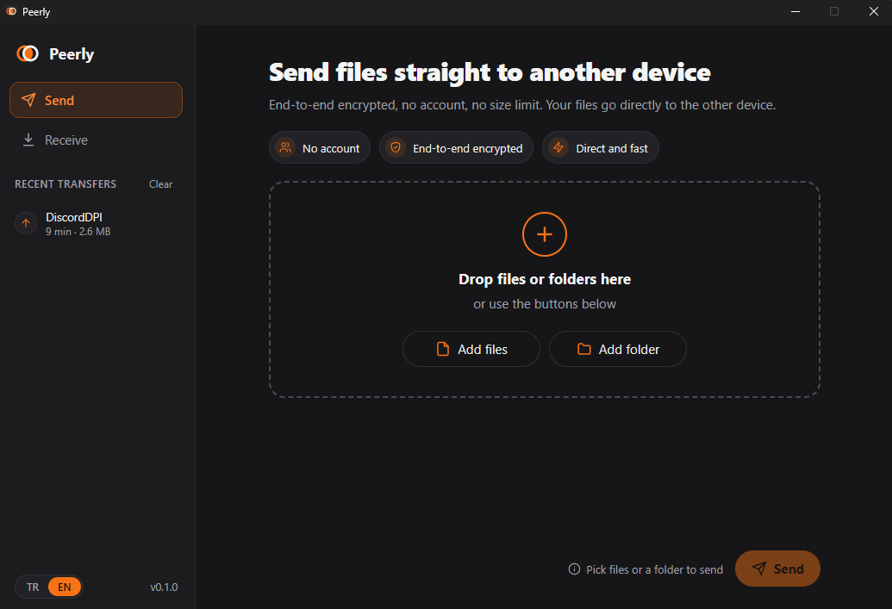
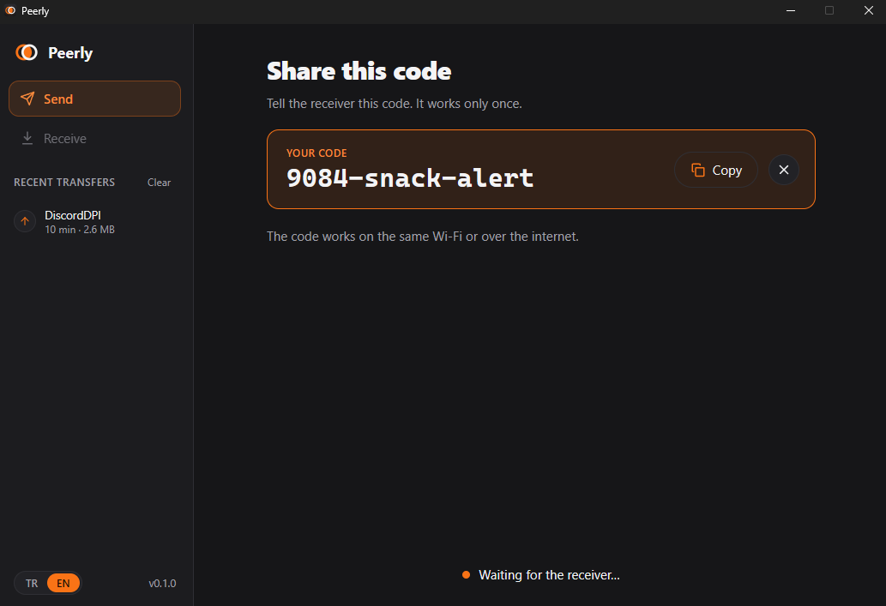
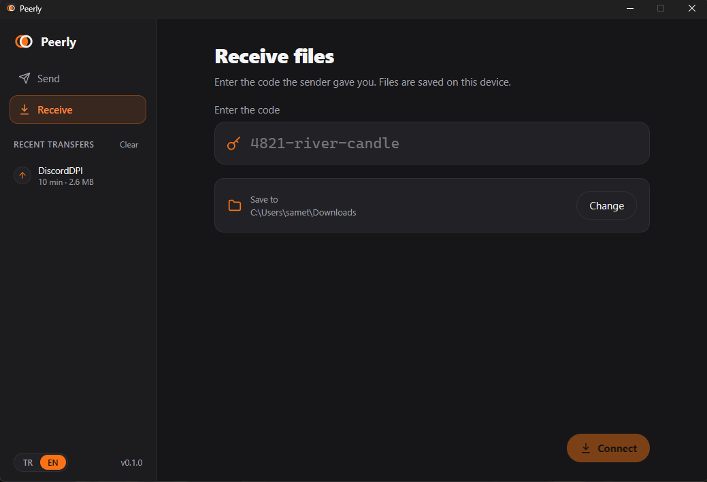

# Peerly

Send files and folders directly from one computer to another. No account, no upload to a cloud, no size limit, no server to run.

<p align="center">
  
  
  
</p>

> Status: **alpha**. Works on Windows and has been tested across the internet between two homes. Expect rough edges; the protocol may still change.

## Why

- **Direct**: bytes flow peer to peer over QUIC. Nothing is uploaded anywhere first, so the transfer runs at the speed of the slower of the two connections.
- **Serverless**: devices find each other on the local network (mDNS) or across the internet through the public BitTorrent DHT. No Peerly server is needed.
- **Encrypted**: every connection is end-to-end encrypted and authenticated with the code; every file is verified with a BLAKE3 hash.
- **Folders included**: send whole folders, any number of files, in parallel streams.

## How to use

1. The sender drops files or a folder into Peerly and clicks **Send**. A code such as `4217-river-candle` appears.
2. The sender tells the receiver the code (chat, phone, anything).
3. The receiver types the code, picks where to save, clicks **Connect** and accepts the offer.
4. Files arrive directly. Each code works once.

## Install

Windows: download `Peerly_x.y.z_x64-setup.exe` from the [Releases](https://github.com/SametDrs/peerly/releases) page and run it. The installer is not code-signed yet, so Windows SmartScreen may warn: click **More info → Run anyway**.

macOS and Linux: build from source (below). CI builds and tests on all three systems.

## How it works

1. The code is `<nameplate>-<word>-<word>`. The number is a public meeting slot; the words never leave your device.
2. Both sides look for each other through every available **mailbox** at once:
   - **LAN**: the sender advertises the nameplate over mDNS; the receiver connects over TCP.
   - **Internet**: both sides exchange messages through BitTorrent Mainline DHT mutable items keyed by the nameplate.
   - **Rendezvous server** (optional): a small WebSocket relay you can self-host.
3. Over that mailbox they run a SPAKE2 key exchange (password = the full code) and exchange sealed connection info: certificate fingerprint and candidate addresses (local + public address learned via STUN).
4. A direct QUIC connection is made (LAN address or UDP hole punching), each side pinning the other's self-signed certificate.
5. Files stream over parallel QUIC streams; the receiver writes to temporary files, checks the BLAKE3 hash, then renames.

See [docs/architecture.md](docs/architecture.md) for the full design.

## Security model

- The code is the shared secret. SPAKE2 turns it into a key without revealing it; a wrong guess fails the exchange and burns the code.
- That key seals each peer's certificate fingerprint and addresses, so neither the DHT nor a rendezvous server can read or swap them.
- QUIC uses self-signed certificates pinned to those fingerprints on both sides.
- The receiver must accept every offer, validates every incoming path (no absolute paths, `..`, reserved names, invisible control characters) and never overwrites existing files.
- In the desktop app the web view never handles file paths; file selection and the save folder are owned by the native side.

The project had an internal security review before release but has **not** been independently audited.

### Known limitations

- If both sides are behind strict (symmetric) NATs, a direct connection may fail. There is no relay fallback yet.
- Someone watching the DHT could occupy or disrupt a nameplate slot (denial of service). They cannot read or alter your files.
- Interrupted transfers do not resume yet.

## Build from source

Requires stable Rust and, for the desktop app, Node.js (LTS) and the [Tauri prerequisites](https://tauri.app/start/prerequisites/).

```sh
# desktop app (Tauri 2 + Svelte)
cd apps/desktop
npm install
npm run tauri dev          # run
npm run tauri build        # installer in target/release/bundle

# command-line client (binary: peerly)
cargo run -p peerly-cli -- send ./some-folder other-file.zip
cargo run -p peerly-cli -- receive 4217-river-candle --to ./downloads

# optional self-hosted rendezvous server
cargo run -p peerly-rendezvous -- --listen 0.0.0.0:9009
```

Environment variables: `PEERLY_RENDEZVOUS=ws://host:9009` adds a rendezvous server, `PEERLY_NO_LAN=1` / `PEERLY_NO_DHT=1` turn off LAN or DHT pairing.

## Contributing

See [CONTRIBUTING.md](CONTRIBUTING.md).

## License

Licensed under either of [MIT](LICENSE-MIT) or [Apache-2.0](LICENSE-APACHE) at your option.

## Türkçe

Peerly, dosya ve klasörleri bir bilgisayardan diğerine **doğrudan** gönderen açık kaynaklı bir masaüstü uygulamasıdır. Hesap yok, buluta yükleme yok, boyut sınırı yok, çalıştırılması gereken bir sunucu yok.

**Nasıl kullanılır?**

1. Gönderen dosya ya da klasörü Peerly'ye sürükler ve **Gönder**'e tıklar. Ekranda `4217-river-candle` gibi bir kod çıkar.
2. Kodu karşı tarafa iletir.
3. Alıcı kodu yazar, kayıt yerini seçer, **Bağlan**'a tıklar ve teklifi onaylar.
4. Dosyalar doğrudan gelir. Her kod tek kullanımlıktır.

**Kurulum (Windows):** [Releases](https://github.com/SametDrs/peerly/releases) sayfasından `Peerly_x.y.z_x64-setup.exe` dosyasını indirip çalıştırın. Kurulum dosyası henüz imzalı olmadığı için SmartScreen uyarı verebilir: **Ek bilgi → Yine de çalıştır**.

**Nasıl çalışır?** Cihazlar birbirini aynı ağdaysa mDNS ile, internet üzerindeyse herkese açık BitTorrent DHT ağı üzerinden bulur. Kod ile SPAKE2 anahtar değişimi yapılır, ardından uçtan uca şifreli doğrudan bir QUIC bağlantısı kurulur. Her dosya BLAKE3 ile doğrulanır. Dosyalarınız hiçbir sunucudan geçmez.

**Bilinen sınırlar:** İki taraf da katı (simetrik) NAT arkasındaysa doğrudan bağlantı kurulamayabilir. Yarıda kalan aktarım henüz devam ettirilemiyor.

Lisans: MIT veya Apache-2.0.
